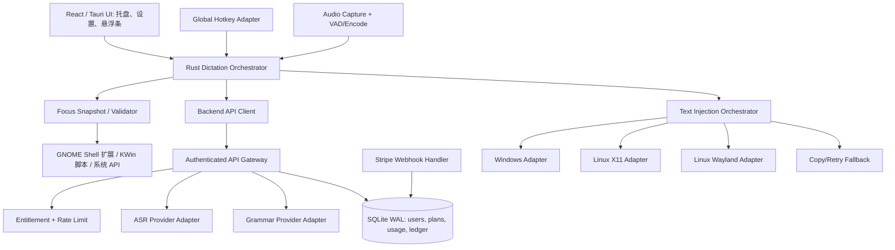
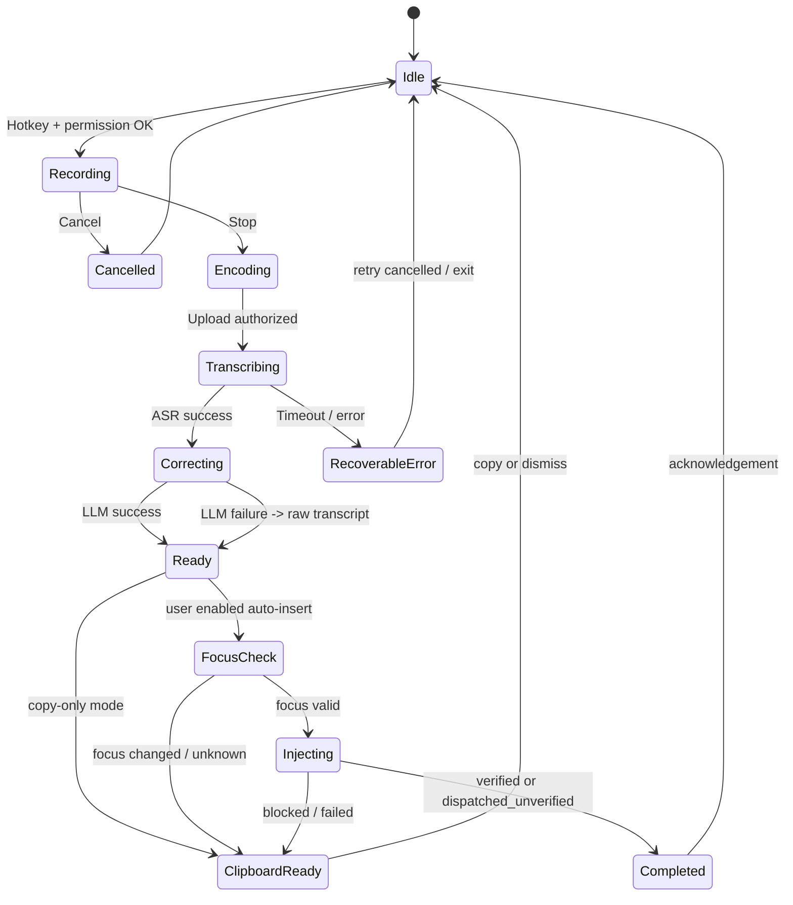

# Scribiva v1.0 — 系统架构设计

**状态**：待 PoC 验证的实施提案 ｜ **日期**：2026-10-26

## 1. 总体原则

1. **桌面优先、跨应用优先**：本地客户端控制录音、热键、焦点与文本注入；后端不需要也不应获得控制用户桌面的能力。
2. **单一语音管线 + 多平台适配器**：Windows 与 Linux 只分叉于权限、热键、焦点、粘贴、打包，ASR/AI/计费共用。
3. **文本与音频最小留存**：默认不存储云端音频；客户端仅为恢复失败结果保留必要的短期文本。
4. **提供商可替换**：语音与语法模型通过服务端接口封装；不得将 Groq/LLM 秘钥嵌入桌面包。
5. **交付确认不能编造**：发送模拟输入不等于目标应用确实插入，结果模型明确 `dispatched_unverified`。
6. **先验证高风险能力**：Linux Wayland、Obsidian、Unicode、撤销和焦点漂移先于界面美化。

## 2. 逻辑架构



> 这里的 API Gateway 为逻辑角色，可以先由一套小型 Web 服务承担，无需单独引入微服务网关。

## 3. 可部署组件

| 组件 | 技术建议 | 责任 | 禁止做的事 |
|---|---|---|---|
| Desktop Shell | Tauri 2 + React + TypeScript | 托盘/设置/悬浮条/状态可视化 | 持有云端模型密钥 |
| Core Orchestrator | Rust | 录音状态、取消、排队、超时、焦点校验 | 未经确认静默插入其他窗口 |
| Audio Capture | Rust 原生库，按平台适配 | 麦克风枚举、音频缓冲、压缩/格式化 | 后台持续监听 |
| Hotkey Adapter | Windows RegisterHotKey；Linux Portal / compositor / 受限后备方案 | 可配置热键、冲突诊断 | 在 Linux 默认读取所有键盘输入 |
| Focus Provider | GNOME Shell 扩展、KWin 脚本、X11/Windows 系统 API（ADR-012） | 只提供焦点窗口的应用 ID 与窗口 ID | 暴露窗口标题或内容 |
| Text Injection | Rust trait + 平台实现 | 后端选择、Unicode 插入、撤销友好 | 承诺注入就一定成功 |
| Backend API | Python 3.12 标准库（`server/scribiva_server/`，ADR-011） | 认证、额度、ASR/LLM 代理、用量流水 | 信任客户端上报用量 |
| Database | SQLite（WAL）单实例 + 定时备份；多实例时迁移 PostgreSQL | 账户、订阅快照、用量事件、幂等 | 存储音频正文作为日志 |
| Billing | Stripe | Checkout、Portal、Webhooks | 用跳转成功 URL 直接授予权益 |
| Observability | 结构化日志 + 可选匿名事件 | 失败率、延迟、后端兼容情况 | 默认上传语音正文 |

### 部署选型建议

- 服务端沿用现有 Python + SQLite 实现，单实例部署，反向代理终止 TLS（ADR-011）；账户采用邮箱魔法链接 + 桌面设备授权登录（FR-019）。
- **部署地区**：服务端与 landing page 部署在美国服务器（ADR-010）。所有地区的客户端（含中国大陆）只连接该服务端，由服务端调用 Groq；客户端不直连任何模型供应商。
- 调用 ASR 和 LLM 必须服务端凭证授权，按用户进行速率、时长与并发限制。
- 录音由客户端上传至服务端；服务端流式转发或短暂存入受限临时存储，处理后立刻清理。必须对文件尺寸、格式和时长做限制。
- 密钥管理与部署环境由 `10-RELEASE-OPERATIONS.md` 详细定义。

## 4. 桌面端模块边界

```text
apps/desktop/
  src/                       # React settings, billing, overlay
  src-tauri/src/
    app.rs                   # 进程生命周期
    dictation/              # state_machine, coordinator, cancellation
    audio/                  # device, capture, encode
    hotkey/                 # windows, x11, wayland
    focus/                  # snapshot + conflict detection
    injection/              # trait, windows, x11, wayland, clipboard
    api/                    # authenticated HTTP client
    storage/                # settings, last_result, secure token store
    telemetry/              # opt-in diagnostic events
server/scribiva_server/      # 现有 Python 服务端：auth, usage, billing, transcription（ADR-011）
extensions/gnome-shell/      # 焦点信息与录音指示扩展（ADR-012）
extensions/kwin/             # KWin 焦点脚本
```

**契约**（伪 Rust 类型，表达行为而非直接可编译代码）：

```rust
trait HotkeyAdapter {
    async fn register(&self, binding: HotkeyBinding) -> Result<HotkeyRegistration, HotkeyError>;
    async fn unregister(&self) -> Result<(), HotkeyError>;
}
trait FocusAdapter {
    fn snapshot(&self) -> FocusSnapshot;
    fn validate(&self, original: &FocusSnapshot) -> FocusState;
}
trait TextInjector {
    async fn capabilities(&self) -> InjectionCapabilities;
    async fn insert(&self, req: InsertRequest) -> InsertOutcome;
}
```

`InsertOutcome` = `verified | dispatched_unverified | clipboard_only | blocked | failed | cancelled`。注入操作生成本地 `operation_id`，每次只有一个进行中的插入，重复结果禁止再次自动发送。

## 5. 听写状态机



**不可变约束**：
- 同一录音只有一个 `job_id` 和一组 `generation/revision`。延迟抵达的转写结果不可覆盖更新的录音。
- 如果用户按取消或关闭程序，即使服务端正在工作，客户端不再插入该结果。
- 先完成文本准备，再检查注入时的焦点；禁止把录音开始时的窗口句柄当成永久有效。
- 语法修正失败时回退 ASR 原文并提示，不能把空响应当成空用户输入。
- 结果可复制，插入失败永不悄悄丢失文字。

## 6. 典型时序

```mermaid
sequenceDiagram
    actor User
    participant OS as OS hotkey / microphone
    participant C as Desktop core
    participant A as Backend API
    participant S as ASR / Grammar
    participant T as Target editor
    User->>OS: 触发快捷键
    OS->>C: pressed
    C->>C: Capture focus snapshot; start recording
    User->>OS: stop
    OS->>C: stopped
    C->>A: POST /v1/dictations (auth, audio, mode)
    A->>A: Validate quota & issue job id
    A->>S: transcribe + optional grammar correction
    S-->>A: raw_text, revised_text
    A-->>C: result, usage, status
    C->>C: validate focus & cancellation token
    alt focus valid
       C->>T: invoke system input adapter
       T-->>C: best-effort dispatch status
    else focus changed or blocked
       C->>User: show copy / retry
    end
```

## 7. 异常处理与韧性

| 异常 | 行为 |
|---|---|
| 无麦克风 / 未授权 | 不启动录音；明确设置跳转指引 |
| ASR 超时 | 保留录音直到用户重试/丢弃；默认不写磁盘；服务端去重请求 |
| AI 修正超时 | 回退原始转写，附提示，不延长到不可接受的等待时间 |
| 焦点丢失 | 禁止自动插入到新窗口，展示预览和复制 |
| 字符插入失败 | 结果保留；按后端能力切换复制模式；不自动重复粘贴 |
| 支付 webhook 重复/乱序 | 事件去重与订阅状态拉取后核对；服务端权益真相源 |
| API 429 | 展示剩余额度/短暂重试信息；指数退避有上限 |
| Linux 依赖缺失 | 环境诊断提示可用输入驱动及安装/权限步骤；无静默 sudo |

## 8. 关键性能测量

客户端埋点（需用户同意）和 QA 测试分别测量：`capture_ms`、`encoding_ms`、`network_ms`、`asr_ms`、`grammar_ms`、`inject_ms`、`end_to_visible_text_ms`。必须分 OS、显示协议、编辑器和语言计算 P50/P95；用户取消的任务不计正常性能。

## 9. 证据和风险

- Tauri 官方全局快捷键插件支持 Linux/Windows，但不保证每个 Wayland 合成器行为相同；需专项适配。
- XDG GlobalShortcuts Portal 定义全局快捷键会话；RemoteDesktop Portal 提供 `ConnectToEIS()` 等输入通道，均依赖桌面环境实现及授权。
- Voxtype 公布了 `wtype/eitype/dotool/ydotool/clipboard/xclip` 输入链；只把它作为参考，不复述为 Scribiva 已实现。

相关官方来源见 [14-SOURCES.md](14-SOURCES.md)。
