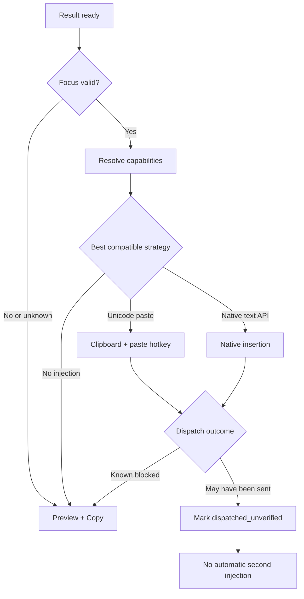

# Scribiva v1.0 — Windows / Linux 输入适配详细设计

**主风险**：跨进程焦点/文本注入，尤其 Linux Wayland。**参考**：Voxtype 多输入驱动架构。

## 1. 统一行为定义

- `HotkeyAdapter`：注册、解除、按下/释放（可选）、检测冲突。所有配置均支持一键回到默认值。
- `FocusAdapter`：记录活动窗口标识、进程、窗口标题（敏感字段不上传）、编辑上下文可用性。若无法可信识别，则返回 `unknown`。
- `InputAdapter`：检测输入能力、选择后端、实际插入、执行错误恢复，报告精确结果状态。
- `ClipboardAdapter`：在获得用户许可时暂存/恢复剪贴板；并发修改期间绝不覆盖新内容。
- `InstallerDoctor`：识别会话类型、门户可用性、依赖、设备权限并给用户可理解的诊断步骤。

## 2. Windows

**推荐 PoC 环境**：Windows 11 x64 普通用户权限；Windows 10 支持声明需另行测试确认。

1. 快捷键：原生 `RegisterHotKey`（或可靠封装）；优先使用简单组合，不默认部署全局低层键盘钩子。
2. 麦克风：Windows 音频 API；枚举输入设备和捕获权限，录音时提供状态提示。
3. 注入策略：优先从 `CF_UNICODETEXT` 剪贴板 + `Ctrl+V` 验证 Unicode 兼容性；再按需求评估 `SendInput`、UI Automation 或 TSF。不同目标编辑器策略可配置。
4. 焦点：注入前校验当前 foreground window 与录音阶段的目标信息；切换后降级为用户确认。
5. UIPI：普通权限进程不能可靠向高完整性进程模拟输入，不请求管理员权限来规避此限制。
6. 剪贴板：粘贴成功不能保证写入；使用变更序号/拥有者检测进行谨慎恢复；不能确定时不恢复并提示。不得在写入时篡改用户已有格式化数据。
7. 撤销：避免逐字符模拟输入导致数百个 Undo 步骤。针对代表应用测试一次撤销是否可恢复整段插入。

**Windows Gate**：Obsidian 双编辑模式、浏览器普通输入框、Word、VS Code 至少通过 Unicode、换行、撤销、焦点变化测试；管理员窗口明确排除。

## 3. Linux 基线与会话识别

检测（只作参考，不信任单个环境变量）：`XDG_SESSION_TYPE`、`WAYLAND_DISPLAY`、`DISPLAY`、桌面/合成器信息、XDG Portal 接口与依赖可执行文件。

| 目标环境 | 推荐快捷键路径 | 推荐文本输出路径 | 重点风险 |
|---|---|---|---|
| X11 | Tauri/global shortcut 或 X11 注册 | XTest 按键触发粘贴 + `xclip` / 受测剪贴板 | 键位布局、输入法、焦点 |
| GNOME Wayland | XDG GlobalShortcuts Portal（可用时）；否则桌面自定义快捷键启动命令 | RemoteDesktop Portal + libei/eitype；经明确授权的 uinput 后备 | Portal 版本/权限、输入通道持续性 |
| KDE Plasma Wayland | Portal 或 KDE 原生自定义快捷键 | libei/eitype，按实测考虑 dotool | Portal 授权 UI、频繁建连开销 |
| Sway/Hyprland | compositor 自定义快捷键或其支持的 Portal | `wtype`；失败则用户可控复制/其他受支持后端 | compositor 特性差异 |
| 其他 Wayland | 标为 Beta 或不支持，待验证 | 不默认假设 `wtype` 可用 | 产品兼容声明失真 |

**重要区别**：`wtype` 适用于实现虚拟键盘协议的某些 wlroots 合成器，不能假定 GNOME/KDE 原生 Wayland 支持。`eitype` 使用 libei/EI；`dotool` 和 `ydotool` 通过 uinput 及相应权限提供备用方式。Voxtype 当前默认链 `wtype → eitype → dotool → ydotool → clipboard → xclip` 可作为策略参考，但 Scribiva 应按场景选择顺序，不能盲目逐一调用导致重复输入。

## 4. Wayland 权限与策略

### A. 优先路线：受桌面环境管理的授权

- **快捷键**：优先 Portal 会话或桌面原生快捷键触发 Scribiva CLI 命令；若 Portal 未实现，向用户展示已验证的桌面设置步骤。
- **输入**：评估 RemoteDesktop Portal 的 EIS/`ConnectToEIS()` 与 libei 发送路径。用户可看到系统授权对话框，拒绝后保持复制模式。
- **注意**：用户授权的有效期和是否可以持久恢复因 Portal/桌面版本而异，不能宣传一次授权永久有效。

### B. 备选路线：uinput

- `dotool` / `ydotool` 在部分环境可用，但可能需要设备权限、udev 规则或专用守护进程。
- **绝不默认把用户加入 `input` 组**；该组可能授予读取实体输入设备的额外能力，不适合作为隐式安装步骤。仅在清晰风险披露、用户主动选择并通过最小权限方案审查后提供后备安装路径。
- 不使用 `sudo scribiva` 运行整个应用；不要自动修改系统规则或部署无签名高权限服务。

### C. 无可用输入驱动

退回**复制文本并明确提示**。如果仅能把文字放进剪贴板而不能发送粘贴快捷键，也不能标记为“已插入”。

## 5. 插入策略与回退（不可重复插入）

**关键**：多个后端只能在“可以确定之前未发送事件”的错误状态下自动回退。若上一驱动返回超时、系统无确认，则停止自动重试并向用户请求确认；否则可能双重粘贴。

## 6. Unicode / Markdown / Obsidian

Obsidian 官方有 Live Preview 和 Source Mode 两种编辑方式，必须分别测试：

- 插入中文、阿拉伯文（RTL）、泰文、日文和 emoji 的 Unicode 顺序。
- 换行、空行、Markdown 标题、列表、引用、链接与代码围栏。
- 光标处插入而非覆盖整个文档；有选区时用户策略是**默认替换选区并提供可撤销**或提示确认（最终 UX 决策需确认）。
- 一次 Ctrl+Z 撤销测试；如果系统以多个 Undo 单元插入，标为已知缺陷且不得通过该应用测试。
- Reading View 不插入；弹出菜单、命令面板、Obsidian 插件造成的焦点偏移需降级为复制。
- AI 不应修改注入前就存在的 Markdown 内容；只处理本次口述片段。

## 7. 调试与兼容报告

本地诊断（默认不联网发送）应包含：OS/版本、显示会话类型、桌面/合成器、Portal 版本/接口可用性、可用输入后端、快捷键状态、授权状态、最近一次错误码。不包含窗口标题、音频、文本正文、剪贴板内容和设备序列号。

建议错误码：`HOTKEY_CONFLICT`、`HOTKEY_PORTAL_UNAVAILABLE`、`MIC_PERMISSION_DENIED`、`FOCUS_CHANGED`、`INPUT_PERMISSION_DENIED`、`INPUT_BACKEND_UNAVAILABLE`、`INPUT_DISPATCH_UNCERTAIN`、`CLIPBOARD_MODIFIED_EXTERNALLY`。

## 8. 实施的先决测试

- T0：静态测试文本插入（无 ASR，无网络），10 次重复无重复插入。
- T1：每种会话写入中英阿测试字符串；含换行、Markdown、emoji。
- T2：录音时 / 处理时切换焦点，不插入无关窗口。
- T3：权限拒绝 / Portal 不可用 / 后端未安装，能够解释和恢复。
- T4：剪贴板被其他程序同时更新，不覆盖该更新。
- T5：Obsidian 两种模式撤销正确、历史笔记未受改动。

参考官方与开源说明见 [14-SOURCES.md](14-SOURCES.md)。
