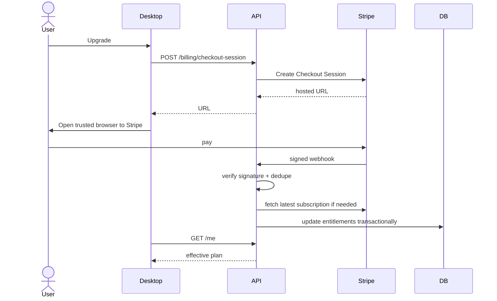

# Scribiva v1.0 — API 契约、数据模型与订阅体系

**状态**：规范草案。示例适合转成 OpenAPI 3.1，但不是已经实现的接口。

## 1. 服务端边界

服务端承担：认证、额度判断、模型请求代理、请求幂等、用量账本、订阅权益、API 频率限制。客户端承担：系统权限、音频采集、处理状态、焦点验证和文本注入。

- HTTPS + Bearer access token，使用可轮换的短期 token；刷新 token 存 OS 安全凭证存储（如 Windows Credential Manager / Linux Secret Service；无安全存储的环境需降级方案）。
- 所有 `user_id` 由后端会话确定，不接受客户端声明的 user_id。
- 模型 API 密钥仅保存在服务端。
- 请求大小、媒体类型、最大持续时长、模型并发均服务端强制。
- v1.0 **同步 API** 可先实现音频处理，但建议保留 `job_id` 和查询状态以兼容长请求；处理超过网关超时时应切异步作业，而不是无限延长连接。

## 2. API 一览

| 方法 | 路径 | 用途 | 身份 |
|---|---|---|---|
| `GET` | `/v1/me` | 用户资料和当前权益 | 必须 |
| `GET` | `/v1/me/usage` | 本期额度/用量 | 必须 |
| `POST` | `/v1/dictations` | 上传语音并发起语音处理 | 必须 |
| `GET` | `/v1/dictations/{job_id}` | 查询作业，恢复网络超时后的结果 | 必须 |
| `POST` | `/v1/dictations/{job_id}/cancel` | 最佳努力取消未完成作业 | 必须 |
| `POST` | `/v1/billing/checkout-session` | 创建订阅结账会话 | 必须 |
| `POST` | `/v1/billing/portal-session` | 管理订阅 | 必须 |
| `POST` | `/v1/webhooks/stripe` | 校验并处理 Stripe 事件 | Stripe 签名 |
| `DELETE` | `/v1/me/data` | 删除可删除的个人数据并触发后台清理 | 必须 + 再验证 |
| `GET` | `/v1/config/public` | 版本兼容、当前功能标记、限额策略摘要 | 可选认证 |
| `POST` | `/v1/auth/magic-link` | 向邮箱发送一次性登录链接（FR-019） | 无，按邮箱和 IP 限流 |
| `POST` | `/v1/auth/device` | 桌面端发起设备授权，返回轮询码 | 无 |
| `POST` | `/v1/auth/device/token` | 桌面端轮询，用户在浏览器确认后颁发 token | 设备码 |
| `GET/PUT` | `/v1/me/dictionary` | 读取/替换个人词典（FR-018） | 必须 |

## 3. 请求 / 响应

### `POST /v1/dictations`

`Content-Type: multipart/form-data`; 必须附带 `Idempotency-Key`（每次录音的 UUID，重试同值）。**字段建议**：

```yaml
fields:
  audio: binary # 受限的 WAV/FLAC/WebM；服务器检查真实内容与媒体类型
  duration_ms: integer # 客户端提示性字段；不能作为最终计费真相
  language: string # 'auto' 或首发 20 个编码
  grammar_mode: string # raw | standard | polished
  output_script: string? # 简中/繁中偏好（仅 language=zh 时使用）
  client_job_id: string # UUID，便于幂等和客户端关联
  client_version: string
```

成功（同步完成的最简单形态）：

```json
{
  "job_id": "job_01JEXAMPLE",
  "status": "completed",
  "raw_text": "I has sent the report yesterday",
  "corrected_text": "I sent the report yesterday.",
  "output_text": "I sent the report yesterday.",
  "detected_language": "en",
  "grammar_mode": "standard",
  "billing": {"charged_audio_seconds": 12, "remaining_free_seconds": 900},
  "warnings": [],
  "processing": {"asr_ms": 890, "grammar_ms": 260}
}
```

若长请求需要排队：`202 Accepted` + `job_id` + `poll_after_ms`，客户端按指数退避轮询。**作业完成后的文本存储有有限 TTL，并明示给用户**；v1.0 推荐最短可操作 TTL（例如 15 分钟，上线前由安全评审批准）。

### 标准错误

```json
{
  "error": {
    "code": "QUOTA_EXCEEDED",
    "message": "Free usage limit reached",
    "retryable": false,
    "request_id": "req_01JEXAMPLE"
  }
}
```

| HTTP | code | 客户端行为 |
|---|---|---|
| 400 | `INVALID_AUDIO` / `UNSUPPORTED_LANGUAGE` | 不重试；提示更换输入/配置 |
| 401 | `AUTH_REQUIRED` | 安全重新登录 |
| 402 / 403 | `QUOTA_EXCEEDED` / `PLAN_INACTIVE` | 展示权益，不上传额外音频 |
| 409 | `IDEMPOTENCY_CONFLICT` | 查原作业，禁止新收费重复作业 |
| 413 | `AUDIO_TOO_LARGE` | 不重试；缩短录音 |
| 422 | `AUDIO_DURATION_INVALID` | 提示录音时长限制 |
| 429 | `RATE_LIMITED` | 读取 `Retry-After`，上限内重试 |
| 502/503/504 | `PROVIDER_ERROR` / `PROVIDER_TIMEOUT` | 提供人工确认的重试/复制 |

## 4. 最小数据库草案

```sql
-- 规划性 DDL（PostgreSQL 语法）。v1.0 实际使用 SQLite（ADR-011），以 `server/scribiva_server/db.py` 的 schema 为准；本草案用于将来迁移时对照。
CREATE TABLE app_users (
  id UUID PRIMARY KEY,
  email TEXT UNIQUE NOT NULL,          -- FR-019：同一邮箱只发放一份免费额度
  created_at TIMESTAMPTZ NOT NULL DEFAULT now(),
  stripe_customer_id TEXT UNIQUE,
  deletion_requested_at TIMESTAMPTZ
);
CREATE TABLE subscriptions (
  id UUID PRIMARY KEY,
  user_id UUID NOT NULL REFERENCES app_users(id),
  stripe_subscription_id TEXT UNIQUE,
  status TEXT NOT NULL,
  plan_code TEXT NOT NULL,
  current_period_end TIMESTAMPTZ,
  updated_at TIMESTAMPTZ NOT NULL DEFAULT now()
);
CREATE TABLE dictation_jobs (
  id UUID PRIMARY KEY,
  user_id UUID NOT NULL REFERENCES app_users(id),
  client_job_id UUID NOT NULL,
  state TEXT NOT NULL,
  audio_duration_ms INT,
  billable_seconds INT,
  language_code TEXT,
  grammar_mode TEXT,
  -- 不默认存转写正文；短期恢复文本在加密 TTL 临时存储
  created_at TIMESTAMPTZ NOT NULL DEFAULT now(),
  UNIQUE(user_id, client_job_id)
);
CREATE TABLE usage_ledger (
  id UUID PRIMARY KEY,
  user_id UUID NOT NULL REFERENCES app_users(id),
  job_id UUID NOT NULL REFERENCES dictation_jobs(id),
  period_start DATE NOT NULL,
  billable_seconds INT NOT NULL,
  event_type TEXT NOT NULL, -- debit | reversal
  created_at TIMESTAMPTZ NOT NULL DEFAULT now(),
  UNIQUE(job_id, event_type)
);
CREATE TABLE processed_webhook_events (
  provider_event_id TEXT PRIMARY KEY,
  received_at TIMESTAMPTZ NOT NULL DEFAULT now()
);
CREATE TABLE user_dictionary_terms (       -- FR-018
  user_id UUID NOT NULL REFERENCES app_users(id),
  term TEXT NOT NULL,
  created_at TIMESTAMPTZ NOT NULL DEFAULT now(),
  PRIMARY KEY (user_id, term)
);
CREATE TABLE auth_magic_links (            -- FR-019；只存哈希，一次性，短时效
  token_hash TEXT PRIMARY KEY,
  email TEXT NOT NULL,
  expires_at TIMESTAMPTZ NOT NULL,
  used_at TIMESTAMPTZ
);
```

**重要**：两个事件类型同 `job_id` 唯一仅适合简单借记/冲正；若以后引入多段计费，需要单独修改唯一约束和流水模式。不能靠本表替代会计账本。

## 5. 额度计算与并发

- `free`（每月免费层，按自然月重置）和 `pro` 额度必须是**服务端配置**，不是客户端常量；订阅结束后回到 `free`。
- 每次录音先申请预留额度（reservation），核对真实解码时长，再提交 `usage_ledger`；发生提供商失败或用户取消按政策解除预留。
- 并发受控：同一用户最多 N 个处理中的作业（初始建议 N=1），同一 client_job_id 幂等。
- **月末宽限**：免费层若本段录音超出剩余额度，允许本段完成并扣至 0，每个计费周期最多一次，单段上限由服务端配置（如 `SCRIBIVA_GRACE_SECONDS`）；之后 `/v1/me/usage` 返回剩余 0，客户端在开始录音前提示。
- 订阅权益用 Stripe webhook + 服务端订阅状态核对，不信任重定向成功页面或客户端 `paid=true`。
- 超时后的重试应先查询相同 `Idempotency-Key` 的结果；不能创建第二次付费处理。

## 6. 支付流程



支付状态至少支持：`trialing`、`active`、`past_due`、`canceled`、`unpaid`。具体何时降级按明确商业规则执行。退款、欺诈、争议、订阅结束（回到免费层）等事件应纳入 webhook 处理设计；新增事件以官方文档为准。

## 7. 数据生命周期

- 音频：默认不持久保存，服务端处理期间暂存并在成功/失败后清理；非正常退出由 TTL 清理任务兜底。
- 文本：服务端默认不做长期持久化，作业结果只在短 TTL 安全存储用于网络恢复；用户明确开启历史功能后才能另行设计。
- 用量：只保留最小计费元数据（秒数、模型类型、状态），不保存语音正文。
- 账户删除：按产品隐私政策、适用合同和合法保留要求执行；用户界面披露不可立即删除的数据类别。

相关：[安全](07-SECURITY-PRIVACY.md) · [指标](11-METRICS-ECONOMICS.md)。

## 8. v1.0 实现契约（2026-10-28，以 `server/scribiva_server/` 为准）

本节是服务端、Linux 客户端与 Windows 客户端共同遵守的接口约定；字段名与上文草案冲突时以本节为准。

### 8.1 设备登录（FR-019）

1. `POST /v1/auth/device`，body `{"client_name": "scribiva-windows"}`（可选）→ `200`：
   `{"device_code": "<43 字符，机密>", "user_code": "ABCD-EFGH", "verification_uri": "https://<host>/login", "verification_uri_complete": "https://<host>/login?code=ABCD-EFGH", "expires_in": 900, "interval": 3}`
2. 客户端用系统浏览器打开 `verification_uri_complete`，用户在网页输入邮箱；服务端发送魔法链接（`POST /v1/auth/magic-link`，body `{"email","user_code"}`，始终返回 `202`，防止枚举邮箱）。
3. 用户点击邮件链接 `GET /auth/verify?token=…` → 确认页 → 表单 `POST /auth/verify` 完成授权（两步是为了防止邮件安全扫描器预取链接时误授权）。
4. 客户端每 `interval` 秒轮询 `POST /v1/auth/device/token`，body `{"device_code"}`：
   - `200` `{"access_token": "scr_…", "token_type": "Bearer", "expires_at": "<ISO>"}`
   - `400` 错误码：`AUTHORIZATION_PENDING`（继续轮询）、`SLOW_DOWN`（间隔 +5 秒）、`EXPIRED_TOKEN`（重新开始）、`INVALID_DEVICE_CODE`

同一邮箱只对应一个账户；删除数据后用同一邮箱重新注册会复用原账户的当月用量，不会再次获得当月免费额度。

### 8.2 个人词典（FR-018）

- `GET /v1/me/dictionary` → `{"terms": ["Kubernetes", "Scribiva"], "max_terms": 200, "max_term_length": 64}`
- `PUT /v1/me/dictionary`，body `{"terms": [...]}`，整体替换，去重保序 → 同上结构
- 服务端在每次听写时自动使用该账户的词典，客户端无需上传。

### 8.3 听写请求与响应补充

`POST /v1/dictations` 新增可选表单字段：

| 字段 | 取值 | 说明 |
|---|---|---|
| `output_script` | `hans` / `hant` / 空 | 仅 `zh` 或自动检测为中文时生效（FR-003） |
| `dictation_commands` | `1`（默认）/ `0` | 口述格式命令开关（FR-016） |

音频格式：`audio/wav`、`audio/flac`、`audio/ogg`（Opus）、`audio/webm`。客户端优先上传 FLAC。

响应新增：

- `suspected_hallucination`（bool）：为 `true` 时客户端**不得自动插入**，只放入恢复区（FR-017）。
- `warnings`：字符串数组，可能含 `GRAMMAR_SKIPPED`、`SUSPECTED_HALLUCINATION`、`SCRIPT_CONVERSION_UNAVAILABLE` 等前缀。
- `billing.resets_at`：本计费周期结束时间（UTC ISO），客户端按本地时区显示。

`GET /v1/me` 与 `GET /v1/me/usage` 的 `usage` 新增 `resets_at` 与 `grace_seconds`。

### 8.4 月末宽限

当 `used < limit` 且 `used + 本段时长 <= limit + grace_seconds` 时允许本段，扣费为 `min(本段时长, limit - used)`，即扣至 0；之后剩余为 0，下一段返回 `402 QUOTA_EXCEEDED`。`grace_seconds` 由 `SCRIBIVA_GRACE_SECONDS` 配置（默认 180）。
