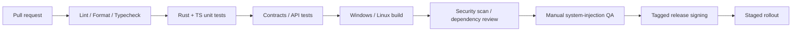

# Scribiva v1.0 — CI/CD、安装包、部署与运行手册

## 1. 交付制品

| 平台 | 第一批制品建议 | 注意 |
|---|---|---|
| Windows | 经签名的安装包（MSI / NSIS 择一） | 代码签名、卸载、自动更新、权限兼容测试 |
| Ubuntu / Debian Linux | `.deb`（单一软件包：Rust/Tauri 应用 + GNOME 扩展 + eitype，不依赖 Python） | 明确支持的 glibc、依赖和 X11/Wayland 设置引导；随包附 eitype 的 Apache-2.0 许可证与依赖清单 |
| Fedora Linux | `.rpm` | 若列为正式支持必须产出并验证；不能仅用 `.deb` 覆盖 |
| 通用 Linux | AppImage（可选） | 权限、Portal、输入驱动依赖不能因自包含包消失 |

目标 CPU/架构：Windows x64、Linux x86_64（其他架构 v1.0 后评估）。各个发行版与安装包具体最低版本由 CI 和 QA 记录，而不是套用 Voxtype 的最低 glibc。

## 2. CI Pipeline（建议）



- PR 必须运行 Rust fmt/clippy/test、ESLint/TypeScript/单测和服务端 API 测试。
- 跨应用输入 UI 自动化需要真实桌面 Runner 或手动 QA；GitHub Actions 的 headless runner **不能**证明 Wayland/Obsidian 兼容。
- 新依赖需许可证审查，特别是从 Voxtype 或其依赖复制源码时保留版权与 MIT 许可文本。
- 构建机、更新服务器、代码签名密钥职责分离；签名秘密不要出现在 PR 流程。

## 3. 后端环境

生产环境、staging 与 landing page 部署在**美国服务器**（ADR-010）。收款使用现有 Stripe 账户。

建议：`dev`、`staging`、`production` 隔离数据库和凭证；Stripe 测试/生产密钥隔离。线上必须 HTTPS，健康检查独立于模型服务可用性检测。

运行配置（均服务端、无明文提交；变量名以 `server/README.md` 为准，下列为规划中的通用名称）：

```dotenv
# .env.example — 只能提交空占位符
DATABASE_URL=
AUTH_JWKS_URL=
ASR_PROVIDER=groq
GROQ_API_KEY=
GRAMMAR_PROVIDER=
GRAMMAR_API_KEY=
STRIPE_SECRET_KEY=
STRIPE_WEBHOOK_SECRET=
STRIPE_PRICE_ID_MONTHLY=
STRIPE_PRICE_ID_ANNUAL=
AUDIO_MAX_SECONDS=120
AUDIO_MAX_BYTES=25000000
JOB_RESULT_TTL_SECONDS=900
LOG_LEVEL=info
```

这些仅是配置建议，`AUDIO_MAX_BYTES` 必须与所购买的服务额度、供应商上限和 API 代理限制共同校准。

## 4. 更新机制

- 稳定版/测试版分渠道，更新 manifest 与制品签名必校验。
- 支持安装失败恢复旧版；配置迁移必须可回滚或先备份。
- 更新前清理进行中的录音并告知用户，不能强制中断未恢复结果。
- Linux 包管理器安装与应用内自动更新互斥或有明确策略，避免双渠道同时覆盖文件。
- 更新被拒绝/下载失败时继续运行旧版，并给出重试入口。

## 5. 监控与告警

只上传经过用户同意的非内容性事件；后端必要运营指标聚合显示：

- ASR/LLM 请求成功率与 P95；模型供应商错误、超额与失败重试。
- 订阅 webhook 延迟/失败、支付状态不一致数量。
- 免费层转付费、活跃付费订阅、MRR、音频使用成本（聚合，免费层单列）。
- 客户端输入驱动错误码按 OS/会话分组；不上传实际输入文字和窗口标题。
- 语音供应商可用性下降时，向用户显示明确服务状态而不是无限重试。
- 从中国大陆网络探测 landing page 与 API 的可达性和延迟，与海外探测分开统计（FR-015）。

## 6. 运营 Runbook

### ASR 服务故障
1. 监控确认供应商错误率上升、暂停重试风暴。
2. 返回 `PROVIDER_UNAVAILABLE` 并告知用户；允许删除或短期保留待手动重试的本地音频。
3. 仅在兼容且已测试条件下切换后备模型；不绕开用户关于第三方数据传输的选择。
4. 恢复后核对超时作业是否被重复计费。

### Stripe webhook 失联
1. 校验 webhook endpoint 与签名错误记录。
2. 重放事件前检查去重表与订阅对象最新状态。
3. 给已支付但权益未同步用户提供有审计记录的修复途径。
4. 修复完成后核对账单事件与权益快照。

### 服务器故障或数据库损坏（ADR-011）
1. 健康检查告警后确认进程、磁盘与 SQLite 完整性（`PRAGMA integrity_check`）。
2. 从最近备份恢复到新实例，切换 DNS 或反向代理上游。
3. 核对恢复点之后的 Stripe webhook 事件，按事件 ID 重放以补齐订阅状态。
4. 记录数据丢失窗口，必要时向受影响用户说明。

### Linux 大面积无法注入
1. 按 distro/compositor/Portal 版本定位失败组合。
2. 禁用有风险的自动后备链，临时改为复制模式。
3. 发布已知问题与可撤销设置步骤；不让用户盲目提权。
4. 修复后在受影响矩阵中逐一回归。

## 7. 发布前清单

- [ ] 系统测试矩阵和 20 语言质量测试通过。
- [ ] Linux 安装权限引导清楚，不默认要求不必要的 `input` 组访问。
- [ ] Windows 签名、Linux 包 checksum 和更新签名可验证。
- [ ] 隐私政策、服务条款、供应商披露、订阅/退款规则已审核。
- [ ] 使用真实 Stripe 测试付款确认权益端到端生效。
- [ ] Landing page 上线且内容与本次发布一致（FR-014）；Windows 与 Linux 安装包同时可下载。
- [ ] 在美国生产服务器上实测 Groq 调用成功（R17）。
- [ ] 失败路径可恢复；更新和卸载清理测试通过。
- [ ] 版本、commit、构建日期和兼容矩阵在发布说明可追溯。


## 8. CI 与发布流程

第 2 节是目标形态；本节描述仓库里**已经存在**的实现：`.github/workflows/ci.yml`、`.github/workflows/release.yml` 和 `scripts/release/`。所有第三方 Action 都按完整 commit SHA 固定（注释里写版本号），升级时同时改 SHA 和注释。

### 8.1 CI（push 到 `main` / `v1-dev`、所有 PR）

| Job | Runner | 内容 |
|---|---|---|
| `python` | ubuntu-24.04 | ruff 0.15.21（`.github/ci-requirements.txt`，带哈希）；`unittest` 全套（装 ffmpeg 以覆盖 FLAC）；`scripts/release` 自测；`tests/test_install.sh`、`tests/test_e2e_simulated.sh` |
| `desktop-linux` | ubuntu-24.04 | Tauri 2 系统依赖、Node 24、`npm ci`、`npm run build`、`cargo fmt --check`、`cargo clippy --all-targets -D warnings`、`cargo test`（都带 `--locked`） |
| `desktop-windows` | windows-2022 | `npm ci`、`npm run build`、clippy、`cargo test` |
| `extension` | ubuntu-24.04 | `node --input-type=module --check` 检查 `extension.js` / `impl.js` 语法；`scripts/release/check_extension.py` 校验 `metadata.json` 并按 `build.sh` 的文件集打包、回读 zip |
| `landing` | ubuntu-24.04 | `scripts/release/check_landing.py landing`：HTML 结构、相对链接与锚点可解析、脚本/样式/图片/iframe 不引用外部 URL（FR-015）|

Rust 工具链固定为 `RUST_TOOLCHAIN`（当前 1.96.1），升级时先在本机跑一遍 clippy。CI 只有 `contents: read` 权限，不接触任何签名密钥。

### 8.2 发布：tag → 草稿 Release → 人工审核发布

1. 改版本号（8 处：`desktop/package.json`、`package-lock.json` 两处、`Cargo.toml`、`Cargo.lock`、`tauri.conf.json`、两个 Python `__init__.py`）：
   ```bash
   python3 scripts/release/bump_version.py --dry-run 1.0.1   # 先看
   python3 scripts/release/bump_version.py 1.0.1
   ```
   非 SemVer 会被拒绝。提交后打带说明的 tag 并推送：`git tag -a v1.0.1 -m "说明"`、`git push origin v1.0.1`。
2. `release.yml` 依次执行：
   - `verify`：`bump_version.py --check` 确认 tag 与所有版本字段一致，不一致直接失败；
   - `linux-deb`：`desktop/packaging/linux/stage.sh`（未设置 `EITYPE_BIN` 时用 `cargo install --locked eitype@0.2.2` 构建）→ `npx tauri build --bundles deb` → `test-deb.sh` 在 runner 的 Docker 里用干净的 `ubuntu:24.04` 安装/卸载验证；
   - `windows-nsis`：`npx tauri build --bundles nsis`，可选 Authenticode 签名，可选 updater 签名；
   - `draft-release`：生成 `latest.json`（仅当 updater 已配置）、`SHA256SUMS`，创建 **草稿** Release 并上传全部制品。
3. 维护者在 GitHub Releases 页面检查草稿：文件名、SHA-256、签名状态、发布说明，在真机上安装验证（第 7 节清单），然后**手动**点 Publish。工作流从不自动发布；对已发布的 Release 重跑工作流会直接失败，不会覆盖。

发布构建不使用依赖缓存，只从锁文件重新构建。`draft-release` 是唯一拥有 `contents: write` 的 job。

### 8.3 需要配置的 Secrets 与变量

签名密钥只放在仓库的 `release` environment（Settings → Environments，建议加 required reviewers 并限制只允许 `v*` tag），`windows-nsis` job 使用这个 environment。

| 名称 | 类型 | 用途 | 缺失时 |
|---|---|---|---|
| `TAURI_SIGNING_PRIVATE_KEY` | secret | updater 私钥（`tauri signer generate` 输出的私钥内容） | 若 `tauri.conf.json` 已配置 `plugins.updater.pubkey`：发布**失败**；未配置 pubkey：不生成 `.sig` 和 `latest.json`，只打警告 |
| `TAURI_SIGNING_PRIVATE_KEY_PASSWORD` | secret | 私钥口令 | 无口令的私钥可以不设 |
| `WINDOWS_CERTIFICATE` | secret | 代码签名证书 PFX 的 base64（`base64 -w0 cert.pfx`） | 不签名，构建仍成功，Release 说明和 `latest.json` 注明 "Unsigned build — SmartScreen will warn" |
| `WINDOWS_CERTIFICATE_PASSWORD` | secret | PFX 口令 | 同上（两个都设置才签名） |
| `WINDOWS_TIMESTAMP_URL` | variable（可选） | RFC 3161 时间戳服务 | 默认 `http://timestamp.digicert.com` |
| `RELEASE_DOWNLOAD_BASE_URL` | variable（可选） | 下载地址前缀，写入 `latest.json` 和 config.js 片段 | 默认 GitHub Release 下载地址 |

注意：基于 PFX 的签名只适用于仍允许导出私钥的证书。2023 年 6 月以后新签发的 OV/EV 证书通常要求私钥在硬件令牌或云 HSM 里，那时需要把 `Import code-signing certificate` 步骤换成供应商的签名服务（`bundle.windows.signCommand`）。

### 8.4 Tauri updater 密钥

```bash
cd desktop
npx tauri signer generate -w ~/.tauri/scribiva-updater.key   # 交互输入口令
```

- 私钥 `~/.tauri/scribiva-updater.key`：内容存为 secret `TAURI_SIGNING_PRIVATE_KEY`，口令存为 `TAURI_SIGNING_PRIVATE_KEY_PASSWORD`；另做离线备份。私钥丢失后已安装的客户端将无法再验证任何更新。
- 公钥 `~/.tauri/scribiva-updater.key.pub`：内容写入 `desktop/src-tauri/tauri.conf.json` 的 `plugins.updater.pubkey`（同时配置 `endpoints`，并启用 `requireSignedVersion`），随代码提交。应用内置这把公钥来验证下载的安装包。
- 写入 pubkey 后，发布工作流自动开启 `bundle.createUpdaterArtifacts`：NSIS 安装包旁会生成 `*.exe.sig`，`scripts/release/make_latest_json.py` 读取它生成 Tauri v2 静态 `latest.json`（`version`、`notes`、`pub_date`、`platforms.windows-x86_64.{signature,url}`）。脚本会检查签名的文件名、版本和密钥 ID 与 `tauri.conf.json` 中的公钥一致，避免把错误的签名发出去。
- 目前桌面端尚未接入 `tauri-plugin-updater`，所以工作流在没有 pubkey 时跳过 updater 制品。

### 8.5 Linux 更新渠道

`.deb` 不经过应用内 updater（`latest.json` 不包含 Linux，`make_latest_json.py` 会拒绝 `.deb`/`.rpm`）：用户从官网下载新版本，或在提供 APT 源后通过 `apt upgrade` 更新。这样避免包管理器与应用内更新同时改写 `/usr` 下的文件（第 4 节）。

### 8.6 更新 landing page 下载信息

草稿 Release 的说明末尾有一段可直接复制的 `landing/assets/config.js` 片段，包含 `version`、`windows_url`、`windows_sha256`、`linux_deb_url`、`linux_deb_sha256`（SHA-256 与 `SHA256SUMS` 相同）。发布后：

1. 若安装包要放在 Scribiva 自有域名（推荐，保证大陆可访问），先上传到镜像，并在发布前设置变量 `RELEASE_DOWNLOAD_BASE_URL`，或手动替换片段里的 URL；
2. 把片段写入 `landing/assets/config.js`，`release_state` 改为 `"available"`；
3. 同步 `landing/README.md` 提到的页面后备文字和下载区示例文件名；
4. 本地运行 `python3 scripts/release/check_landing.py landing` 后再部署。
