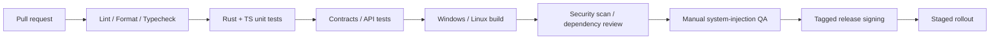

# Scribiva v1.0 — CI/CD、安装包、部署与运行手册

## 1. 交付制品

| 平台 | 第一批制品建议 | 注意 |
|---|---|---|
| Windows | 经签名的安装包（MSI / NSIS 择一） | 代码签名、卸载、自动更新、权限兼容测试 |
| Ubuntu / Debian Linux | `.deb`（单一软件包：Rust/Tauri 应用 + GNOME 扩展 + eitype，不依赖 Python） | 明确支持的 glibc、依赖和 X11/Wayland 设置引导；随包附 eitype 的 Apache-2.0 许可证与依赖清单 |
| Fedora Linux | `.rpm` | 若列为正式支持必须产出并验证；不能仅用 `.deb` 覆盖 |
| 通用 Linux | AppImage（可选） | 权限、Portal、输入驱动依赖不能因自包含包消失 |

目标 CPU/架构：Windows x64、Linux x86_64（其他架构 v1.0 后评估）。各个发行版与安装包具体最低版本由 CI 和 QA 记录，而不是套用 Voxtype 的最低 glibc。

## 2. CI Pipeline（建议）



- PR 必须运行 Rust fmt/clippy/test、ESLint/TypeScript/单测和服务端 API 测试。
- 跨应用输入 UI 自动化需要真实桌面 Runner 或手动 QA；GitHub Actions 的 headless runner **不能**证明 Wayland/Obsidian 兼容。
- 新依赖需许可证审查，特别是从 Voxtype 或其依赖复制源码时保留版权与 MIT 许可文本。
- 构建机、更新服务器、代码签名密钥职责分离；签名秘密不要出现在 PR 流程。

## 3. 后端环境

生产环境、staging 与 landing page 部署在**美国服务器**（ADR-010）。收款使用现有 Stripe 账户。

建议：`dev`、`staging`、`production` 隔离数据库和凭证；Stripe 测试/生产密钥隔离。线上必须 HTTPS，健康检查独立于模型服务可用性检测。

运行配置（均服务端、无明文提交；变量名以 `server/README.md` 为准，下列为规划中的通用名称）：

```dotenv
# .env.example — 只能提交空占位符
DATABASE_URL=
AUTH_JWKS_URL=
ASR_PROVIDER=groq
GROQ_API_KEY=
GRAMMAR_PROVIDER=
GRAMMAR_API_KEY=
STRIPE_SECRET_KEY=
STRIPE_WEBHOOK_SECRET=
STRIPE_PRICE_ID_MONTHLY=
STRIPE_PRICE_ID_ANNUAL=
AUDIO_MAX_SECONDS=120
AUDIO_MAX_BYTES=25000000
JOB_RESULT_TTL_SECONDS=900
LOG_LEVEL=info
```

这些仅是配置建议，`AUDIO_MAX_BYTES` 必须与所购买的服务额度、供应商上限和 API 代理限制共同校准。

## 4. 更新机制

- 稳定版/测试版分渠道，更新 manifest 与制品签名必校验。
- 支持安装失败恢复旧版；配置迁移必须可回滚或先备份。
- 更新前清理进行中的录音并告知用户，不能强制中断未恢复结果。
- Linux 包管理器安装与应用内自动更新互斥或有明确策略，避免双渠道同时覆盖文件。
- 更新被拒绝/下载失败时继续运行旧版，并给出重试入口。

## 5. 监控与告警

只上传经过用户同意的非内容性事件；后端必要运营指标聚合显示：

- ASR/LLM 请求成功率与 P95；模型供应商错误、超额与失败重试。
- 订阅 webhook 延迟/失败、支付状态不一致数量。
- 免费层转付费、活跃付费订阅、MRR、音频使用成本（聚合，免费层单列）。
- 客户端输入驱动错误码按 OS/会话分组；不上传实际输入文字和窗口标题。
- 语音供应商可用性下降时，向用户显示明确服务状态而不是无限重试。
- 从中国大陆网络探测 landing page 与 API 的可达性和延迟，与海外探测分开统计（FR-015）。

## 6. 运营 Runbook

### ASR 服务故障
1. 监控确认供应商错误率上升、暂停重试风暴。
2. 返回 `PROVIDER_UNAVAILABLE` 并告知用户；允许删除或短期保留待手动重试的本地音频。
3. 仅在兼容且已测试条件下切换后备模型；不绕开用户关于第三方数据传输的选择。
4. 恢复后核对超时作业是否被重复计费。

### Stripe webhook 失联
1. 校验 webhook endpoint 与签名错误记录。
2. 重放事件前检查去重表与订阅对象最新状态。
3. 给已支付但权益未同步用户提供有审计记录的修复途径。
4. 修复完成后核对账单事件与权益快照。

### 服务器故障或数据库损坏（ADR-011）
1. 健康检查告警后确认进程、磁盘与 SQLite 完整性（`PRAGMA integrity_check`）。
2. 从最近备份恢复到新实例，切换 DNS 或反向代理上游。
3. 核对恢复点之后的 Stripe webhook 事件，按事件 ID 重放以补齐订阅状态。
4. 记录数据丢失窗口，必要时向受影响用户说明。

### Linux 大面积无法注入
1. 按 distro/compositor/Portal 版本定位失败组合。
2. 禁用有风险的自动后备链，临时改为复制模式。
3. 发布已知问题与可撤销设置步骤；不让用户盲目提权。
4. 修复后在受影响矩阵中逐一回归。

## 7. 发布前清单

- [ ] 系统测试矩阵和 20 语言质量测试通过。
- [ ] Linux 安装权限引导清楚，不默认要求不必要的 `input` 组访问。
- [ ] Windows 签名、Linux 包 checksum 和更新签名可验证。
- [ ] 隐私政策、服务条款、供应商披露、订阅/退款规则已审核。
- [ ] 使用真实 Stripe 测试付款确认权益端到端生效。
- [ ] Landing page 上线且内容与本次发布一致（FR-014）；Windows 与 Linux 安装包同时可下载。
- [ ] 在美国生产服务器上实测 Groq 调用成功（R17）。
- [ ] 失败路径可恢复；更新和卸载清理测试通过。
- [ ] 版本、commit、构建日期和兼容矩阵在发布说明可追溯。

