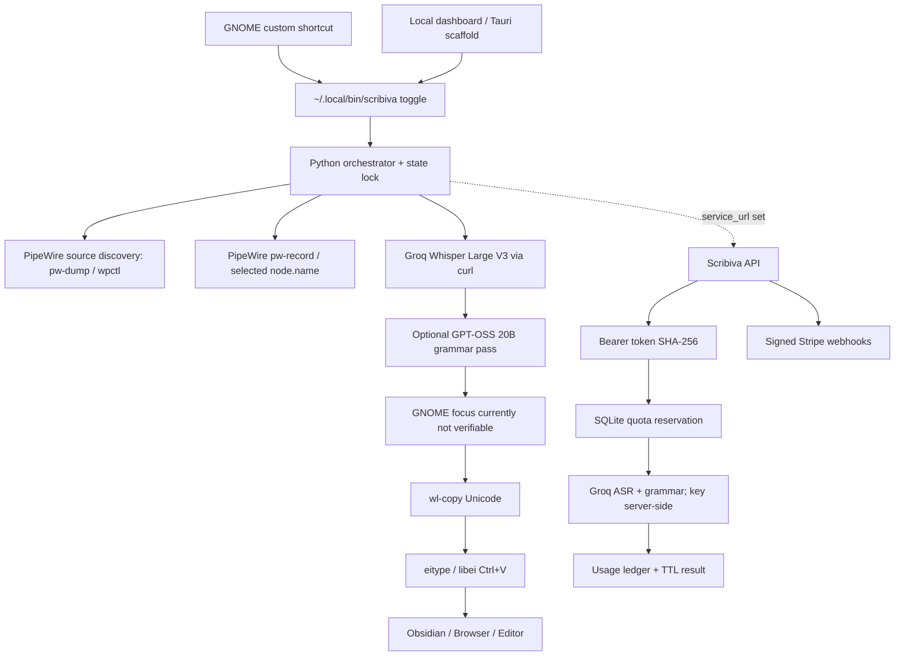

# Scribiva — alpha technical architecture

## Shipped layers

CLI is the stable local development boundary. The Tauri React shell invokes the CLI with whitelisted commands through a Rust-only IPC API (no user-controlled shell command strings). GNOME hotkey remains configured independently of the Tauri window. Python will gradually be ported to Rust once operating-system integration is stable.

There are two transport modes. **Direct mode** (`service_url` empty) keeps the developer-owned Groq key locally and makes two provider calls (ASR, then grammar). **Service mode** stores only a revocable Bearer token (`~/.config/scribiva/service-token`, `0600`) and makes one authenticated multipart request to the Scribiva API; the server holds the Groq key, reserves quota transactionally, and returns raw + edited text. Service mode is an early backend skeleton, not a production deployment: SQLite and the rate limiter are single-node.

## State machine

`idle -> recording -> processing -> injecting -> idle`

Additional states: `error`, `cancelled -> idle`. `discard` deletes retained failed audio or drops a pending result; `clear-last` removes both stored transcript variants. Each job carries a random 128-bit ID and unique WAV path. The second hotkey event verifies the `pw-record` PID/cmdline before sending `SIGTERM`, escalating to `SIGKILL` only after re-verifying the same cmdline. A short grace period permits WAV flushing. Long-running network operations execute in a detached worker, preventing GNOME shortcut invocation from blocking. A watchdog stops recordings after configurable `max_record_seconds`. Results are written only after the final cancellation check, so a cancelled job cannot overwrite `last-result.txt` or auto-insert.

## Core modules

| Module | Responsibility |
|---|---|
| `config.py` | Settings validation, directories, microphone node and key paths |
| `devices.py` | PipeWire source enumeration, default-source metadata, `wpctl` fallback |
| `audio.py` | PipeWire recorder control, sample RMS analysis |
| `providers.py` | Groq curl API request, ASR, grammar, protected token guardrails |
| `inject.py` | Wayland Unicode clipboard / eitype single dispatch |
| `engine.py` | Locked recording / job state / notifications / retry |
| `cli.py` | CLI contract, hotkey entrypoint, diagnostics |
| `dashboard.py` | Loopback-only HTTP control UI, origin and request-token checks |

Server modules (`server/scribiva_server/`). Decision D-006 is closed by ADR-011: v1.0 keeps this Python stdlib + SQLite server as a single US-hosted instance behind a TLS reverse proxy. Storage and transport stay replaceable behind `DictationService` for a later PostgreSQL migration if multi-instance deployment becomes necessary.

| Module | Responsibility |
|---|---|
| `config.py` | Environment-only settings, loopback default, plan limits |
| `db.py` | SQLite WAL schema, `BEGIN IMMEDIATE` quota reservation, ledger, job states, webhook dedupe, privacy deletion |
| `auth.py` | Opaque `scr_` tokens, SHA-256 storage, expiry/revocation, Bearer parsing |
| `audio.py` | Server-side WAV duration (stdlib) and `ffprobe` for other containers; reject when unknown |
| `multipart.py` | Bounded multipart parsing without third-party dependencies |
| `textguard.py` | Protect/restore URLs, code, paths, emails, numbers and Markdown markers; fail closed |
| `provider.py` | Groq ASR/chat adapter; key never leaves the process |
| `service.py` | API semantics: auth, rate limit, idempotency, cancel/expiry, usage, billing |
| `http.py` | `ThreadingHTTPServer` routes, body caps, structured errors, no content logging |
| `stripe.py` | HMAC-SHA256 webhook verification, Checkout/Portal REST, subscription event mapping |
| `__main__.py` | `serve`, `init-db`, `create-user`, `issue-token`, `revoke-token`, `show-user`, `grant-pro` |

## Known architecture gaps

1. Linux GNOME focus identity is not validated; switching apps during processing can change the insertion destination. Disabling auto-insert copies instead. The planned fix is a GNOME Shell extension that exposes the focused window ID over D-Bus (ADR-012).
2. `eitype` returning success means only that paste was dispatched, **not verified** by the target editor.
3. Clipboard rich-data preservation is incomplete; original text flavor is restored best-effort only.
4. The server proxy exists as a stdlib/SQLite skeleton. Before production it still needs TLS termination, backups, magic-link account login (FR-019), full Stripe test-mode E2E, abuse controls and audit retention. PostgreSQL and distributed rate limiting are deferred until multi-instance deployment (ADR-011).
5. Linux X11, KDE Wayland, other Wayland and Windows are not implemented in this delivery.
6. ASR support for 20 languages is configured but **not independently tested** for every language.
7. Grammar LLM heuristics are conservative, but context-dependent rewriting can still alter meaning; show raw fallback and enable raw mode.
8. API Cloudflare 1010 must be resolved with the provider; no fingerprint or TLS circumvention is coded.
9. Reusing the GNOME custom hotkey as the long-term Linux installation path is temporary. Production will use platform-consistent registration when supported.
10. Device hotplug is re-read on demand; there is no persistent device-change subscription or no-focus-steal recording overlay yet.

## Future native boundary

`platform_adapter` should expose `MicRecorder`, `ShortcutListener`, `FocusGuard`, `TextInjector`, `ClipboardRestorer`. Windows implementation requires real machine QA using `RegisterHotKey`, `SendInput` / clipboard and user privilege restrictions.
